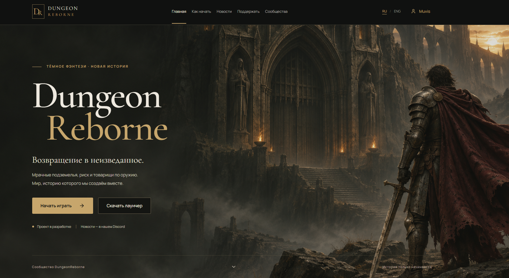
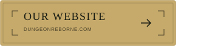
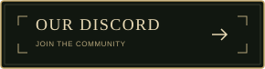
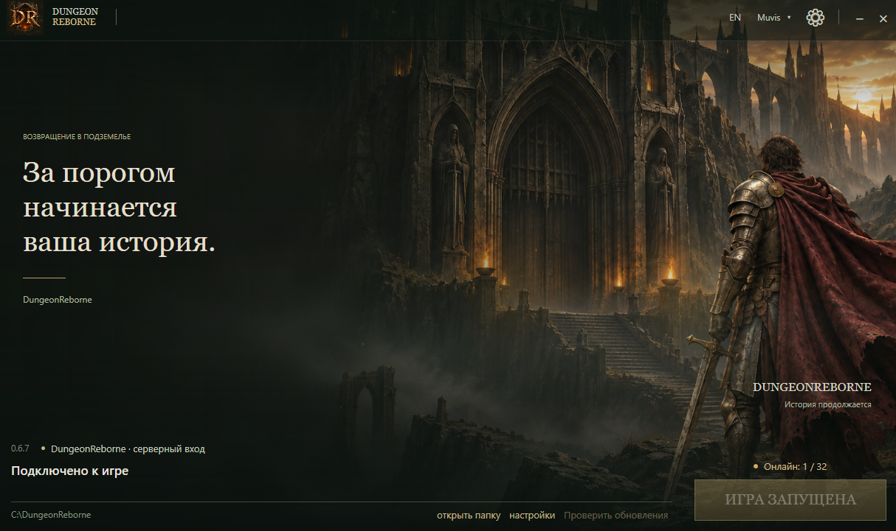

# ⚔️ DungeonReborne — a project for the Dungeonborne community

**Dark dungeons · PvPvE · RU / ENG community**

**DungeonReborne** is an independent project for **Dungeonborne** players who enjoy dark fantasy, dungeon exploration, dangerous raids, and the fight for loot. We are developing the project's infrastructure: a website, a custom launcher, an account system, and game servers.

If you are looking for a **Dungeonborne server**, interested in the Dungeonborne community, or want to follow DungeonReborne, start at **[dungeonreborne.com](https://dungeonreborne.com)**.

> The project is under development. We are preparing for launch — follow our website and Discord for updates.

  
  

---

## 🛡️ What is DungeonReborne?

DungeonReborne brings together game infrastructure development and a community of Dungeonborne fans. Our goal is to make the journey from registration to playing straightforward: create an account on the website, open the launcher, download the required files, and connect to an available server.

We care about the experience players value in Dungeonborne: tense PvPvE encounters, class teamwork, finding equipment, and deciding whether to push deeper into a raid or extract with your loot.

We are building DungeonReborne step by step and want to discuss its development with players, from launcher usability to game mechanics and balance.

---

## 🌐 DungeonReborne website and accounts for Dungeonborne players

The **[DungeonReborne website](https://dungeonreborne.com)** includes an evolving registration, sign-in, and account system. Website accounts are used to sign in to our launcher. Work continues on integration with in-game profiles and validation of the complete gameplay cycle.

Players should not have to manually configure files before every session. The DungeonReborne website and launcher are being developed as a clear entry point for the Dungeonborne community.

---

## 🖥️ DungeonReborne launcher for the Dungeonborne community

We have written a custom launcher interface in C# for DungeonReborne. Its responsibilities include website-based authentication, game client downloads, file verification, updates, and launching the game. For members of the Dungeonborne community, it provides a single entry point to our project’s game infrastructure.

On first launch, the application displays its interface and automatically prepares its support files in AppData. There is no setup wizard to complete or system folder to select. Downloading the game itself is a separate action, started with the **Install** button.

The launcher is under active development. Compatibility, updates, and installation flows are still being tested. Bug reports help us improve it before wider testing.

---

## 🏰 Dungeonborne game servers and testing

One of DungeonReborne's main priorities is preparing the server infrastructure and testing player connections. Before opening to the public, we need to verify a multiplayer raid across separate computers, extraction, and inventory persistence after signing in again.

We are preparing for the DungeonReborne launch. Information about available servers, connection requirements, and project development is published on our website and Discord.

If you are looking for **where to play Dungeonborne**, follow our announcements for confirmed details about public testing, server availability, and required client versions.

---

## 💬 The Dungeonborne community at DungeonReborne: RU and ENG

Our **[Discord community](https://discord.gg/J9rmpSzBkf)** has Russian and English sections. They include general chat, news, development updates, ideas and suggestions, balance feedback, bug reports, and a channel for newcomers.

Suggestions from the Dungeonborne community are organized by topic:

- Classes.
- Weapons.
- Mobs.
- Bosses.
- Economy.
- Mechanics.
- Other.

We invite Dungeonborne players to share specific suggestions and observations. When reporting a bug, please include your game or launcher version, steps to reproduce it, the expected result, and a screenshot or video where possible.

---

## 🧭 Developing DungeonReborne for the Dungeonborne community

Our immediate priorities are reliable client installation and updates, the account system, server infrastructure, and verification that game progress is saved correctly. Alongside this work, we will continue improving the website, publishing DungeonReborne news, and collecting feedback from the Dungeonborne community.

Follow our website and Discord for launch news, connection requirements, and additional project features.

---

## 🔎 About the project and gaming community

Looking for **where to play Dungeonborne** or **how to play Dungeonborne after shutdown**? DungeonReborne is an independent community project preparing for launch. We are developing an unofficial Dungeonborne community server, a custom PC launcher, and an account system to make getting into the game straightforward.

Our Russian and English Dungeonborne community brings together players interested in co-op PvPvE raids, classes, equipment, and dungeon exploration. The DungeonReborne website provides project news and getting-started instructions, while Discord is a place to find teammates, discuss game mechanics, and suggest improvements.

Follow the development of the DungeonReborne server on [our website](https://dungeonreborne.com) and in [our community Discord](https://discord.gg/J9rmpSzBkf). Connection instructions and game server availability will be covered in our launch news.

---

## ❓ DungeonReborne and Dungeonborne FAQ

### Is DungeonReborne an official Dungeonborne project?

No. DungeonReborne is an independent community project. We do not claim official status or affiliation with the rights holders of Dungeonborne. References to Dungeonborne describe the game and the audience our project serves.

### How do I get started with DungeonReborne?

Visit **[dungeonreborne.com](https://dungeonreborne.com)**, read the latest announcements, and review the getting-started and account instructions. Access to the game depends on the current testing stage and server availability.

### Where can I read DungeonReborne news for the Dungeonborne community?

Development news and announcements are published on **[our website](https://dungeonreborne.com)** and in **[our Discord](https://discord.gg/J9rmpSzBkf)**.

### Where can Dungeonborne players follow the DungeonReborne server launch?

We are preparing for launch. Follow our website and Discord for opening announcements and connection instructions.

### Can I suggest Dungeonborne-related changes for the project?

Yes. Dungeonborne players can share ideas in the DungeonReborne community, which has dedicated forums for game mechanics and balance suggestions. Suggestions are considered in the context of the project's capabilities and current development stage.

---

## 🌍 DungeonReborne — for the Dungeonborne community

DungeonReborne is an independent community project for Dungeonborne players. We are developing a website, account system, a custom Windows launcher, and game server infrastructure.

The project is under active development and we are preparing for launch. Follow **[DungeonReborne](https://dungeonreborne.com)** and our Discord for launch news, connection instructions, and launcher updates.

**Official DungeonReborne project website: [dungeonreborne.com](https://dungeonreborne.com).**

---

**Join the DungeonReborne community**

  
  

